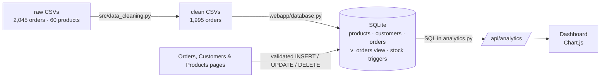
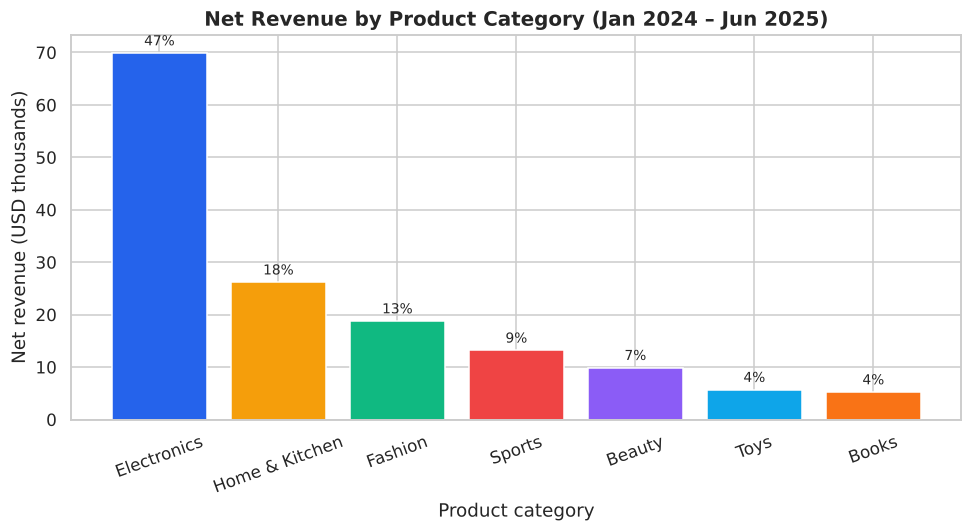
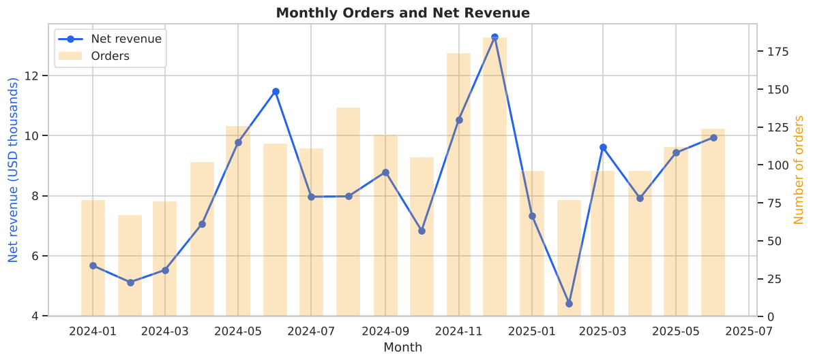
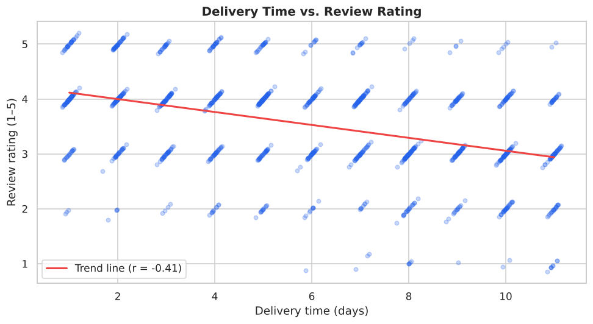
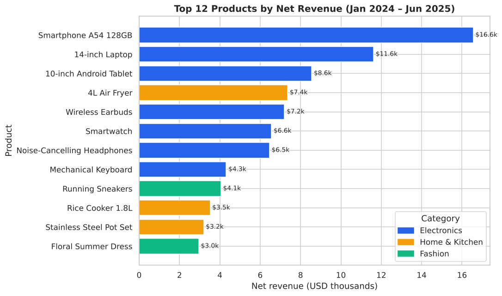

# E-commerce Customer Analytics

> An end-to-end data analytics project using **Python & Pandas** to clean, explore, analyse and visualise 18 months of e-commerce order data, and to turn the results into evidence-based business recommendations.

   

---

## 1. Problem statement & scope

An online retailer selling across seven Southeast-Asian markets has grown quickly but has never analysed its order history systematically. Management does not know **which products, customer groups and markets drive revenue**, **whether customers come back after their first purchase**, or **why some customers leave poor reviews and return products**.

**In scope:** order-level transactions from 1 Jan 2024 – 30 Jun 2025 (2,045 raw rows / 1,995 after cleaning), a product catalogue of 60 products in 7 categories and 30 subcategories (e.g. Books → Comics & Manga, Programming, Fiction), each with a fixed price and stock on hand, customer attributes (age, gender, country, segment, channel), order attributes (product, price, discount, payment, device, delivery time, status, rating), data cleaning, descriptive & statistical analysis, and visualisation.

**Out of scope:** cost/margin data, price changes over time, predictive modelling, web-analytics events.

## 2. Objectives & analytical questions

| # | Objective | Success measure |
|---|-----------|-----------------|
| O1 | Identify the main revenue drivers | Revenue share per category / subcategory / product / segment / country / channel; groups producing ≥ 80 % of revenue |
| O2 | Measure retention and value concentration | Repeat-purchase rate, revenue share of top 20 % customers, churn-risk share |
| O3 | Diagnose service-quality problems | Correlation of delivery time with rating; return rate per category |

**Analytical questions**

1. Which product categories generate the most revenue, and which have the highest return rates?
2. How do customer segments (New / Regular / VIP) differ in order frequency, order value and total spend?
3. How do orders and revenue trend month by month — is there seasonality?
4. Which countries and acquisition channels bring the most valuable customers?
5. Does delivery time affect the review rating customers give?
6. What share of customers are repeat buyers, and how many are at risk of churning?
7. Do device usage and payment preferences differ across age groups?
8. Which products and subcategories sell best, and which products are about to run out of stock?

## 3. Project structure

```
ecommerce-customer-analytics/
├── data/
│   ├── raw/ecommerce_orders_raw.csv          # 2,045 rows, includes deliberate quality issues
│   ├── raw/products.csv                      # product catalogue: 60 products, fixed price + stock
│   ├── processed/ecommerce_orders_clean.csv  # 1,995 rows × 34 columns after cleaning
│   └── processed/products.csv                # validated catalogue loaded by the web app
├── notebooks/
│   └── ecommerce_customer_analytics.ipynb    # main analysis (executed, with outputs)
├── src/
│   ├── generate_dataset.py                   # reproducible generator: product catalogue + orders
│   ├── data_cleaning.py                      # reusable cleaning pipeline + customer table
│   └── run_pipeline.py                       # one-command: generate -> clean -> execute notebook
├── webapp/                                   # Flask + SQLite web app (live dashboard + order management)
│   ├── app.py                                # routes, validation, CSRF — run: python webapp/app.py
│   ├── database.py                           # schema (tables, constraints, view, triggers) + CSV loader
│   ├── analytics.py                          # every dashboard number, computed with SQL
│   ├── templates/                            # Jinja pages: dashboard, orders, customers, products, forms
│   └── static/                               # CSS, JS, vendored Chart.js (works offline)
├── tests/
│   ├── test_data_cleaning.py                 # pytest suite for the cleaning pipeline (16 tests)
│   └── test_webapp.py                        # database, API, CRUD, stock, validation & security tests (42 tests)
├── .github/workflows/ci.yml                  # GitHub Actions: tests + pipeline on every push
├── outputs/
│   └── figures/                              # 10 charts exported from the notebook
├── docs/
│   ├── data_dictionary.md                    # field-by-field data dictionary
│   ├── project_report.docx                   # written report
│   ├── presentation.pptx                     # slides for the live demo
│   ├── dashboard.html                        # interactive offline dashboard: 4 tabs, filters, dark mode, demo guide
│   ├── notebook_export.html                  # static HTML export of the executed notebook (no kernel needed)
│   └── demo_notebook_script.md               # section-by-section speaking script for the live demo
├── README.md
├── LICENSE
├── requirements.txt
└── .gitignore
```

## 4. Dataset

The dataset is **synthetic but realistic**: `src/generate_dataset.py` simulates 2,000 orders from ~720 customers with seasonal demand, segment-dependent purchase frequency, category-dependent prices and return rates, and a delivery-time → rating relationship. It then deliberately injects **missing values, 45 duplicate rows, 25 out-of-range values and inconsistent category spelling** so the cleaning steps have realistic work to do. Regenerate it with `python src/generate_dataset.py` (seed 42 → identical file).

Full field descriptions: [`docs/data_dictionary.md`](docs/data_dictionary.md).

## 5. How to run

```bash
# 1. Clone and install
git clone https://github.com/hinrithisak-eng/ecommerce-customer-analytics.git
cd ecommerce-customer-analytics
python -m venv .venv && source .venv/bin/activate   # Windows: .venv\Scripts\activate
pip install -r requirements.txt

# 2. (Optional) regenerate the raw dataset and run the cleaning pipeline from the CLI
python src/generate_dataset.py
python src/data_cleaning.py

# 3. Open the notebook
jupyter notebook notebooks/ecommerce_customer_analytics.ipynb

# Or reproduce everything with one command (generate -> clean -> execute notebook)
python src/run_pipeline.py

# Run the web app (Flask + SQLite) — see section 6
python webapp/app.py

# Run the unit tests (58 tests: pipeline + web app)
pytest -q
```

The notebook runs top-to-bottom in ~15 seconds (`Kernel → Restart & Run All`) and writes the charts to `outputs/figures/`.

## 6. Web app — live dashboard on a SQLite database

The analysis also runs as a full web application: the dashboard reads **live from a SQLite database**, and orders, customers and products can be added, edited and deleted in the browser — every change shows up on the dashboard within seconds.

```bash
pip install -r requirements.txt
python webapp/app.py              # first run builds webapp/instance/ecommerce.db from the cleaned CSV
                                  # then open http://127.0.0.1:5000
python webapp/app.py --reset      # rebuild the database from the CSV (undoes all demo edits)
```



| Page | What it does |
|------|--------------|
| **Dashboard** `/` | KPI cards with month-on-month change, revenue/orders trend (6M · 12M · all), monthly target gauge (latest month vs. the monthly average + 10%), top-categories donut, a **Southeast Asia map** shaded by net revenue per country, an order-fulfilment funnel (placed → shipped → delivered & kept → reviewed), acquisition channels, recent orders, a recent-activity feed, best-selling products and stock alerts. Country / Segment / Category filters are kept in the URL. Polls a change counter and refreshes itself when the data changes. Light and dark themes. |
| **Customers & service** `/analytics/customers` | Segments, recency, order-value distribution, country, channel, payment mix and service-quality charts, each with a Chart / Table switch. |
| **Orders** `/orders` | Search, filter, sort and page through orders; add, edit, delete. In the order form you pick a category, then a product: the **price is filled in from the catalogue** (it can't be typed), the stock on hand is shown, and the quantity can't exceed it. |
| **Products** `/products` | The catalogue: category, subcategory, fixed price, stock on hand (low / out-of-stock badges), units sold and revenue per product. Add products, change prices (applies to new orders only) and restock. A product that appears on orders can't be deleted. |
| **Customers** `/customers` | Same for customers, with order count and net spend per customer. A customer who still has orders can't be deleted. |
| **API** | `/api/analytics?country=&segment=&category=` (all dashboard numbers as JSON), `/api/version`, `/api/customers/<id>` |

**Database design** (`webapp/database.py`)

| Object | Purpose |
|--------|---------|
| `products` | The catalogue: one row per product with its category, subcategory, fixed `unit_price`, `stock_on_hand` (`CHECK ≥ 0`) and `reorder_level`. |
| `customers` | One row per customer (normalised out of the order rows). 71 customers had conflicting ages/cities across orders because of per-order imputation; the loader keeps each customer's most frequent value. |
| `orders` | One row per order, `FOREIGN KEY → customers` and `→ products`, both `ON DELETE RESTRICT`. `unit_price` stores the list price at the time of the order. |
| Stock triggers | A delivered order takes its quantity out of `stock_on_hand`; cancelling, returning or deleting it puts the units back. If an order would push stock below zero, the `CHECK` fails and the database refuses it — even if the form were bypassed. |
| `CHECK` constraints | The cleaning rules from notebook §8 enforced by the database itself — quantity 1–50, price > 0, discount 0–100 %, rating 1–5, delivery 0–30 days, valid categories and products, and "a cancelled order has no delivery time or review". |
| `v_orders` view | `total_amount`, `net_revenue`, `age_group`, `order_month`, `customer_tenure_days` computed on the fly, so derived values can never go stale after an edit. |
| `meta` + triggers | A change counter bumped on every insert/update/delete; the dashboard polls it to auto-refresh. |

Validation happens twice — in Python with friendly field-level messages, and again by the database constraints — and every form is CSRF-protected. Loading the 1,995 cleaned orders reproduces the notebook exactly ($148,675 net revenue, $91.90 average order, r = −0.41), which `tests/test_webapp.py` checks.

## 7. Methodology (mapped to the notebook sections)

| Step | Notebook section | What is done |
|------|------------------|--------------|
| Load & explore | §5 | `head`, `shape`, `columns`, `info`, `describe` |
| Missing values | §6 | `isnull()` audit; median (age), mode (payment), mode-within-country (city), catalogue look-up (price); structural NaNs kept |
| Duplicates | §7 | 45 exact duplicates removed → 2,000 rows |
| Validation | §8 | Type checks, category domains, numeric range rules (age 18–100, rating 1–5, discount 0–100 …), logical rule order ≥ sign-up, every order priced at its product's list price; 5 rows dropped, 23 prices restored → 1,995 rows |
| Derived columns | §9 | `total_amount`, `net_revenue`, `customer_tenure_days`, `age_group`, `order_value_tier`, flags … (11 columns) |
| Pandas analysis | §10 | filtering, sorting, `groupby`/`agg`, `pivot_table`, `crosstab`, customer-level RFM table, product & subcategory ranking, stock cover |
| Statistics | §11 | mean/median/mode/min/max/std/var, skewness, correlation matrix, t-test, chi-square, ANOVA |
| Visualisation | §12 | 10 charts (bar, line, histogram, pie, scatter, box, grouped bar, heatmap, stacked bar, horizontal bar), each with interpretation |
| Findings | §13 | 8 findings, 7 recommendations, limitations |

## 8. Key findings

1. **Revenue is concentrated in Electronics and in a few products** — 47 % of net revenue from 24 % of orders; Electronics + Home & Kitchen + Fashion ≈ 77 %. The top 10 of 60 products earn 51 %; the Smartphone A54 alone 11 %.
2. **VIP customers drive value through frequency** — 23 % of customers, 40 % of revenue, 4.9 orders each vs 1.6 for New; order value per order is *not* significantly different (p = 0.26).
3. **Slow delivery hurts ratings** — 3.97 ★ for 1–3-day delivery vs 3.00 ★ for 10+ days; r = −0.41, p < 0.001.
4. **18 % of orders produce no revenue** — 11.2 % returned + 6.6 % cancelled; Fashion has the highest return rate (15.7 %), and return rates differ significantly by category (χ² p = 0.015).
5. **Strong year-end seasonality** — December 2024 ≈ 2.4× the Q1 monthly average; January revenue −45 % month-on-month.
6. **Good retention, but many dormant customers** — 67 % repeat rate, top 20 % of customers = 59 % of revenue, yet 45 % inactive > 180 days.
7. **Referral brings the least valuable customers** ($145 per customer vs $246 for Email).
8. **Stock gaps are costing sales** — 2 products are sold out (Noise-Cancelling Headphones ≈ $775 of revenue a month) and 4 more are at or below their reorder level.

## 9. Recommendations

1. Set a ≤ 5-day delivery SLA in the top three markets and show delivery estimates at checkout.
2. Launch a second-purchase voucher programme for New customers and a win-back campaign for the 45 % dormant customers.
3. Cut Fashion returns with size guides, fit reviews and return-reason tracking, starting with the most-returned products.
4. Diversify revenue by cross-selling Home & Kitchen appliances and Sports bundles to Electronics buyers.
5. Plan inventory & ad budget around the Nov–Dec peak and run a January promotion to soften the trough.
6. Rebalance acquisition spend from Referral toward Email / Organic Search; pay referral rewards only after the second order.
7. Reorder from the stock-cover table: restock sold-out products now and reorder anything under 2 months of cover (the web app's Products page flags these).

## 10. Sample visualisations

| | |
|---|---|
|  |  |
|  |  |

## 11. Live demo script (≈ 10 minutes)

Close the demo with the **live web app** (`python webapp/app.py`, section 6): add an order on stage and watch the dashboard update. `docs/dashboard.html` is the no-server fallback — it works offline with no Python running. Four tabs (Overview · Customers & service · Data quality · Findings & demo), Country / Segment / Category filters that recompute every chart, KPI and interpretation sentence live, and a light/dark theme that follows your OS setting. Keyboard: `1`–`4` switch tabs, `D` toggles dark mode, `R` resets filters. The **Findings & demo** tab holds the minute-by-minute script and likely Q&A.

1. Show the repo structure and `README` (1 min).
2. Run `python src/generate_dataset.py` → show `df.describe()` revealing the bad values (1 min).
3. Walk through notebook §6–§8: missing values, duplicates, validation report (2 min).
4. Show 2–3 analysis tables (category, segment, delivery vs rating) (2 min).
5. Show the charts and the findings / recommendations table (2 min).

## Author

**Sak** — E-commerce Customer Analytics project, 2026.
